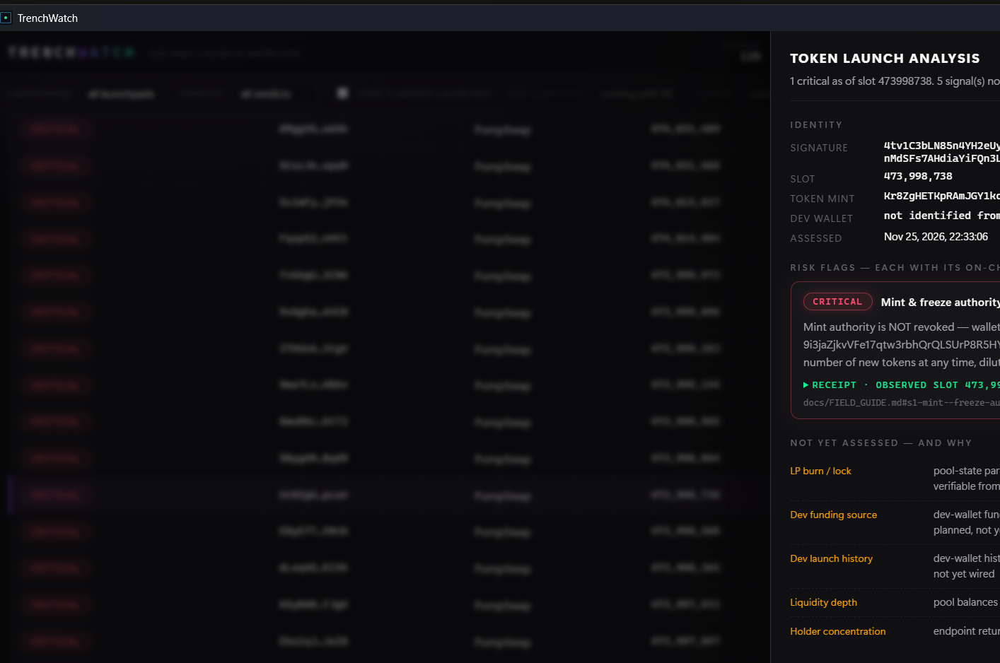

# TrenchWatch


Real-time monitor for brand-new token launches on Solana mainnet-beta, with
explainable rug-pull risk scoring. Every flag ships with plain-language
evidence and an on-chain receipt you can verify yourself — no black-box
scores.

Built to demonstrate hands-on Solana data-infrastructure skills: websocket
ingestion under rate limits, account parsing, and evidence-backed heuristics.

## What it does

- **Watches** Raydium, Orca, and PumpSwap pool creations + Pump.fun
  graduations over a websocket RPC subscription, in real time.
- **Scores** each launch against six rug-pull signals (mint/freeze authority,
  LP burn/lock, dev-wallet funding, dev-wallet history, holder concentration,
  thin liquidity). Each signal produces `{flag, severity, explanation,
  on-chain evidence, field-guide reference}` — see
  [docs/FIELD_GUIDE.md](docs/FIELD_GUIDE.md).
- **Shows** a dense mission-control dashboard: live table, detail drawer with
  full evidence receipts, filters.
- **Alerts** via desktop notification and optional Discord webhook.

## See it in action

Running live against Solana mainnet-beta — real launches, real verdicts:


Every row opens a full evidence receipt — identity, signature, the exact
risk flags with their on-chain proof, and an honest list of what hasn't
been assessed yet:



## Watch it fire live

A community TrenchWatch watcher posts real graduations and critical-flag
receipts as they happen — no setup required:

**[Join the TrenchWatch alerts server](https://discord.gg/SNjAp6FQB)**
(the same invite is one click away in the app's top bar).

## What it deliberately cannot do

TrenchWatch is **read-only by design**: no trading, no private keys, no
wallet custody, no transaction signing. There is no code path that could move
funds — the RPC layer exposes only a whitelist of read-only methods. The
full reasoning is in [docs/THREAT_MODEL.md](docs/THREAT_MODEL.md), written
before any functional code.

## Architecture

```
[ Solana mainnet-beta ]──wss──>[ provider ]─>[ pipeline ]─>[ risk engine ]
                                                              │
                              [ dashboard ]◀──IPC──[ store ]──┤
                                                              ▼
                                                     [ alerts: desktop + Discord ]
```

- Rust backend (Tauri v2) owns all chain I/O, analysis, storage, alerting.
- `ChainProvider` trait isolates RPC behind one interface. The launch
  stream rides the free public websocket; set `rpc.api_key` and the
  analysis reads (parsed transactions, mint accounts, holders) switch to
  metered Helius calls with a configurable daily cap and automatic
  fallback to the public endpoint — a config-level change, zero refactor.
  Details: [docs/ARCHITECTURE.md](docs/ARCHITECTURE.md).
- React + TypeScript frontend, no telemetry, CSP-locked.

## Quickstart (~10 minutes on a fresh Windows machine)

No accounts, no API keys, no cost: TrenchWatch runs entirely on Solana's
free public RPC out of the box — everything below works as-is. The optional
[Helius key](#optional-helius-enrichment) is an upgrade, not a requirement.

Prerequisites: [Node.js](https://nodejs.org) (LTS), the
[Rust toolchain](https://rustup.rs) (`rustup-init.exe` → default install,
includes MSVC build tools via Visual Studio Build Tools), and WebView2
(pre-installed on Windows 11).

```bash
git clone <repo-url> trenchwatch
cd trenchwatch
npm install
npm run tauri dev
```

The first `tauri dev` builds the Rust backend from scratch — expect a few
minutes of compiler output before the window opens; later starts are
seconds. That's it — the app connects to mainnet-beta and starts
surfacing launches within a minute of the window appearing. It runs entirely on your machine; there is no
server to host and nothing to deploy. First run uses built-in defaults
(public endpoint, no Discord, no Helius). To customize, copy
`config.example.toml` to `config.toml` next to the app and edit — see the
[config reference](#configuration) below.

## Configuration

All settings live in `config.toml` (gitignored — never commit it). Every
key is documented in [config.example.toml](config.example.toml):

| Key | Default | Meaning |
|-----|---------|---------|
| `rpc.ws_url` | public mainnet-beta endpoint | WebSocket RPC URL. The launch stream always rides this. |
| `rpc.api_key` | `""` | Optional Helius API key. When set, analysis reads switch to metered Helius calls; empty = public endpoint for everything. |
| `rpc.daily_credit_cap` | `100000` | Daily budget for Helius read calls (`0` = unlimited, not recommended). At the cap the app falls back to the public endpoint. |
| `monitor.min_liquidity_usd` | `0` | Liquidity floor for surfacing launches. |
| `alerts.desktop_notifications` | `true` | Desktop notification on flagged launches at or above `alerts.min_severity`. |
| `alerts.min_severity` | `"critical"` | Lowest severity that alerts: `critical`, `warn`, or `info`. |
| `alerts.discord_webhook_url` | `""` | Optional Discord webhook; empty disables. |
| `storage.store_dir` | `"store"` | Local event store location. |

### Optional: Helius enrichment

Skip this section and everything still works — this is purely an upgrade
for faster, more reliable analysis reads, and it only spends credits on
those reads (never on the launch stream).

1. Copy your API key into `api_key` in `config.toml` (next to the app data
   directory, already gitignored — never the repo).
2. Restart the app. The top bar shows `helius: used / cap` counting read
   calls for the day; the launch stream stays on the free websocket either
   way.
3. If Helius errors or the cap is hit, reads fall back to the public
   endpoint automatically — analysis never stalls.

### Optional: Discord alerts

Get flagged-launch receipts posted to a Discord channel you control.
Skip this section and desktop notifications still cover you — Discord is
just for alerts that follow you onto your phone.

**Setting it up (about 2 minutes):**

1. Open Discord and pick a server where you can manage webhooks — any
   server you own works. Don't have one? Click the `+` in the server
   list and create a free private server just for alerts.
2. Right-click the server name → **Server Settings** → **Integrations** →
   **Webhooks** → **New Webhook**.
3. Pick the channel the alerts should land in (for example `#alerts`),
   give the webhook any name — the app overrides it with `TrenchWatch` —
   then click **Copy Webhook URL**. It looks like
   `https://discord.com/api/webhooks/<id>/<token>`.
4. Paste that URL into the **discord webhook** field in the app's
   Settings drawer (or set `alerts.discord_webhook_url` in `config.toml`
   next to the app data directory), then restart the app.
5. Choose how chatty it should be: the **alert threshold** in Settings
   defaults to critical-only. Set it to `warn` or `every flag` for
   more traffic.

**What you'll receive:** one message per flagged launch, styled as an
embed with the severity color, the token's mint address, the on-chain
signature, and the top risk flag in plain words — enough to decide
whether to open the app for the full evidence trail.

**What leaves your machine:** nothing but those POSTs to the exact URL
you pasted. No analytics, no telemetry. If Discord rejects or can't be
reached, the alert is skipped and the reason is logged — monitoring
never stalls on a chat outage.

## Docs

- [docs/ARCHITECTURE.md](docs/ARCHITECTURE.md) — module map and data flow.
- [docs/THREAT_MODEL.md](docs/THREAT_MODEL.md) — adversaries, trust
  boundaries, and how non-goals are structurally enforced.
- [docs/FIELD_GUIDE.md](docs/FIELD_GUIDE.md) — every signal explained in
  plain language, with false-positive rates.

## Contributing

Contributions welcome — see [CONTRIBUTING.md](CONTRIBUTING.md). Conventional
commits, clippy-clean Rust, every risk signal must ship with evidence and
tests.

## Disclaimer

TrenchWatch produces heuristics with evidence, not financial advice. It
never labels a token "safe" — only "no flags found as of slot N". Public
chain data can be spoofed (see the threat model); do your own research.

## License

[MIT](LICENSE)
